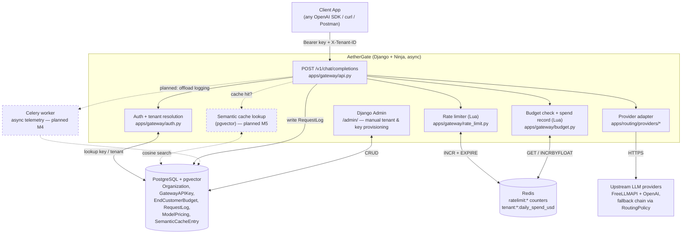
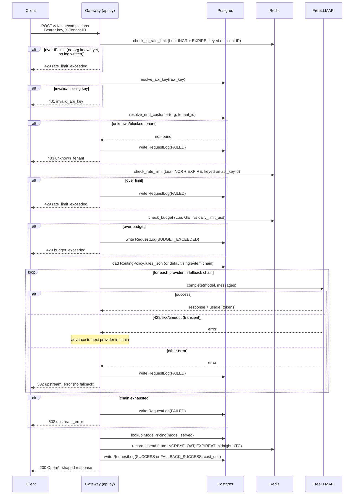

# AetherGate

A lightweight, self-hosted, OpenAI-compatible LLM proxy gateway built for SaaS startups. AetherGate reduces API spend via semantic caching, prevents single-provider outages via automatic fallback, and enforces real-time per-tenant dollar budgets. It's a drop-in `base_url` replacement with built-in cost governance and observability — see [claude.md](claude.md) for the full architecture spec.

## Tech stack

Python 3.12, Django 5.x + Django Ninja (async proxy views), PostgreSQL 16 + pgvector (semantic cache), Redis (budgets/rate limiting), httpx (upstream LLM calls), Celery (post-request telemetry, M4+).

## High-level design

### Components



### Request flow — `POST /v1/chat/completions`



**Legend:** dashed boxes/edges = planned, not yet implemented (semantic cache → M5, Celery-offloaded telemetry → M4). Everything else above is shipped (M1 + M2 + M2.5 + M3).

## Local setup

```bash
cp .env.example .env   # fill in FREELLMAPI_TOKEN and any other secrets
docker compose up -d db redis
docker compose run --rm web python manage.py migrate
docker compose run --rm web python manage.py createsuperuser
docker compose up web
```

Then via `/admin/`: create an `Organization`, a `GatewayAPIKey` (the raw key is shown once on creation — copy it), and an `EndCustomerBudget` for whichever `external_tenant_id` you'll test with. Tenant provisioning is manual-only; unrecognized `X-Tenant-ID`s are rejected with `403`.

Try it:

```bash
curl -X POST http://localhost:8000/v1/chat/completions \
  -H "Authorization: Bearer <raw_key>" -H "X-Tenant-ID: acme-corp" \
  -H "Content-Type: application/json" \
  -d '{"model":"auto","messages":[{"role":"user","content":"Say hello in one word"}]}'
```

Or seed a demo org/key/tenant automatically:

```bash
docker compose run --rm web python scripts/seed_demo_data.py
```

### Inspecting the data stores

- **pgAdmin** (Postgres UI): `docker compose up -d pgadmin` → `http://localhost:5050`
- **RedisInsight** (Redis UI): `docker compose up -d redisinsight` → `http://localhost:5540`. Useful for inspecting live budget (`tenant:*:daily_spend_usd`) and rate-limit (`ratelimit:*`) keys.

## Tests, lint, types

```bash
pytest                 # or: make test
pytest --cov           # or: make test-cov
ruff check .           # or: make lint
ruff format .          # or: make format
mypy apps config       # or: make typecheck
```

A `Makefile` wraps all of the above plus `make up` / `make down` / `make migrate`. Optional: `pre-commit install` to run ruff automatically on commit (see `.pre-commit-config.yaml`).

## Status

**M1 shipped**: single-provider (FreeLLMAPI) non-streaming passthrough with auth, manual tenant-check, and request logging.

**M2 shipped**: atomic Redis-backed daily budget enforcement and per-API-key rate limiting, both pre-flight (before any upstream call).

**M2.5 shipped**: pre-auth, IP-based rate limiting — a second, independent limiter (`IP_RATE_LIMIT_PER_MINUTE`, default 300/min) that runs before the Postgres auth lookup, protecting the server from unauthenticated/invalid-key request floods. The per-API-key limiter from M2 still runs separately afterward for authenticated abuse.

**M3 shipped**: multi-provider fallback. `RoutingPolicy.rules_json` defines a per-org fallback chain (up to 3 attempts: primary + 2 fallbacks); on a transient upstream failure (429/5xx/timeout) the gateway advances to the next provider automatically. `ProviderCredential.encrypted_api_key` is now real (Fernet-encrypted, admin-managed), and a second provider (`OpenAIProvider`) proves the mechanism end-to-end. Orgs with no `RoutingPolicy` configured see unchanged M1/M2 behavior — a single provider attempt.

Planned next: M4 streaming + Celery telemetry → M5 semantic cache → M6 dashboard polish (custom Django admin views, no separate frontend).
